# Thiết kế cơ sở dữ liệu TaskFlow

> Phiên bản đồng bộ với frontend hiện tại ngày 18/10/2026. Tên trường ở API
> dùng `camelCase`; tên cột PostgreSQL dùng `snake_case`.

## 1. Quy ước thiết kế

- PostgreSQL 16, khóa chính UUID. Thời điểm có giờ dùng `timestamptz` và lưu UTC; ngày thuần túy trên giao diện dùng kiểu `date`.
- Xóa mềm bằng `deleted_at` cho dữ liệu nghiệp vụ quan trọng; dữ liệu liên kết có thể xóa cứng.
- Tất cả truy vấn nghiệp vụ phải kiểm tra quyền qua `project_members`.
- Mỗi dự án được tạo sẵn các vai trò `owner`, `manager`, `member`, `viewer`; tên vai trò và tập quyền có thể chỉnh sửa.
- Thứ tự kéo-thả dùng `numeric(20,10) position` để không phải đánh lại toàn bộ thứ tự.
- Các quan hệ có nguy cơ tham chiếu chéo dự án dùng khóa ngoại ghép với `project_id` để database tự chặn dữ liệu sai phạm vi.
- Một task có thể có nhiều người thực hiện qua bảng `task_assignees`; không lưu đồng thời `assignee_id` trong `tasks` để tránh hai nguồn dữ liệu mâu thuẫn.
- Mỗi task có tối đa một `reviewer_id`; người duyệt phải là thành viên của cùng dự án và là bắt buộc trước khi task vào trạng thái `review`.
- Task quá hạn lưu `overdue_reason`; trường này bắt buộc trước lần chuyển trạng thái tiếp theo. Kết quả bàn giao/nghiệm thu được lưu riêng trong `acceptance_result`.
- File vật lý lưu ở MinIO; database chỉ lưu metadata và `object_key`.
- `project.key` là duy nhất, được dùng cùng `tasks.number` để tạo mã công việc như `TF-124`.
- Mỗi task bắt buộc có `start_date` và `end_date`; `end_date` không được trước `start_date`.
- Mỗi dòng timesheet thuộc đúng một task và lưu một phiên bắt đầu–kết thúc; số phút được database tự tính.
- Frontend hiện dùng bốn loại task: `epic`, `story`, `task`, `bug`; không lưu story point.
- Các giá trị tổng hợp như tiến độ dự án, tổng phút đã log, số bình luận, số tệp và tiến độ checklist được truy vấn từ bảng nguồn, không lưu lặp trong `tasks` hay `projects`.

## 2. Sơ đồ quan hệ

```mermaid
erDiagram
    USERS ||--o{ OAUTH_ACCOUNTS : links
    USERS ||--o{ AUTH_SESSIONS : authenticates
    USERS ||--o{ PROJECTS : owns
    USERS ||--o{ PROJECT_MEMBERS : joins
    PROJECTS ||--o{ PROJECT_MEMBERS : has
    PROJECTS ||--o{ PROJECT_INVITATIONS : invites
    PROJECTS ||--o{ PROJECT_ROLES : defines
    PROJECT_ROLES ||--o{ PROJECT_MEMBERS : assigns
    PROJECT_ROLES ||--o{ PROJECT_INVITATIONS : assigns
    PROJECT_ROLES ||--o{ PROJECT_ROLE_PERMISSIONS : grants
    PERMISSIONS ||--o{ PROJECT_ROLE_PERMISSIONS : includes
    PROJECTS ||--o{ STATUSES : defines
    PROJECTS ||--o{ SPRINTS : plans
    PROJECTS ||--o{ TASKS : contains
    USERS ||--o{ TASKS : reports
    USERS ||--o{ TASKS : reviews
    TASKS ||--o{ TASK_ASSIGNEES : assigned_to
    USERS ||--o{ TASK_ASSIGNEES : works_on
    STATUSES ||--o{ TASKS : classifies
    SPRINTS o|--o{ TASKS : groups
    PROJECTS ||--o{ LABELS : defines
    TASKS ||--o{ TASK_LABELS : tagged
    LABELS ||--o{ TASK_LABELS : labels
    TASKS ||--o{ CHECKLIST_ITEMS : contains
    TASKS ||--o{ COMMENTS : discusses
    USERS ||--o{ COMMENTS : writes
    TASKS ||--o{ ATTACHMENTS : has
    USERS ||--o{ ATTACHMENTS : uploads
    TASKS ||--o{ TASK_WATCHERS : watched_by
    USERS ||--o{ TASK_WATCHERS : watches
    TASKS ||--o{ TIME_ENTRIES : tracks
    USERS ||--o{ TIME_ENTRIES : logs
    PROJECTS ||--o{ PROJECT_DOCUMENTS : stores
    USERS ||--o{ PROJECT_DOCUMENTS : uploads
    PROJECTS ||--o{ MEETINGS : schedules
    USERS ||--o{ MEETINGS : creates
    MEETINGS ||--o{ MEETING_ATTENDEES : includes
    USERS ||--o{ MEETING_ATTENDEES : attends
    TASKS ||--o{ TASK_LINKS : source
    TASKS ||--o{ TASK_LINKS : target
    USERS ||--o{ NOTIFICATIONS : receives
    PROJECTS ||--o{ ACTIVITY_LOGS : records
    PROJECTS ||--o{ CUSTOM_FIELDS : defines
    TASKS ||--o{ TASK_CUSTOM_VALUES : has
    CUSTOM_FIELDS ||--o{ TASK_CUSTOM_VALUES : stores
    USERS ||--o{ SAVED_VIEWS : owns
```



## 3. Danh mục bảng

| Nhóm | Bảng | Mục đích |
|---|---|---|
| Tài khoản | `users` | Hồ sơ, email, mật khẩu và trạng thái tài khoản |
| Tài khoản | `oauth_accounts` | Liên kết danh tính Google và GitHub với người dùng |
| Tài khoản | `auth_sessions` | Refresh token và phiên đăng nhập có thể thu hồi |
| Dự án | `projects` | Đơn vị dữ liệu cao nhất, thay thế phạm vi Workspace |
| Phân quyền | `project_roles` | Vai trò có thể chỉnh sửa riêng trong từng dự án |
| Phân quyền | `permissions`, `project_role_permissions` | Danh mục quyền và quyền được cấp cho từng vai trò |
| Dự án | `project_members` | Thành viên và vai trò trong từng dự án |
| Dự án | `project_invitations` | Lời mời tham gia trực tiếp vào dự án |
| Quy trình | `statuses` | Các cột/trạng thái Kanban tùy biến |
| Quy trình | `status_transitions` | Các bước chuyển trạng thái được phép |
| Sprint | `sprints` | Backlog và sprint của dự án |
| Công việc | `tasks` | Epic, Story, Task và Bug |
| Công việc | `task_assignees` | Liên kết nhiều-nhiều giữa task và người thực hiện |
| Công việc | `task_links` | Quan hệ blocks, relates, duplicates giữa task |
| Phân loại | `labels`, `task_labels` | Nhãn của dự án và liên kết nhiều-nhiều với task |
| Cộng tác | `checklist_items` | Checklist con của task |
| Cộng tác | `comments` | Bình luận dạng cây bằng `parent_id` |
| Cộng tác | `attachments` | Metadata file lưu trên MinIO |
| Cộng tác | `task_watchers` | Người theo dõi task |
| Theo dõi | `time_entries` | Các phiên timesheet nằm trong từng task |
| Tài liệu | `project_documents` | Metadata tài liệu dùng chung của dự án |
| Meeting | `meetings`, `meeting_attendees` | Lịch họp và danh sách người tham gia |
| Cá nhân hóa | `custom_fields`, `task_custom_values` | Trường tùy chỉnh theo dự án |
| Giao diện | `saved_views` | Bộ lọc và cách hiển thị đã lưu |
| Thông báo | `notifications`, `notification_settings` | Thông báo và tùy chọn của người dùng |
| Kiểm toán | `activity_logs` | Audit log bất biến theo dự án |

Các bảng `sprints`, `status_transitions`, `task_links`, `task_watchers`,
`custom_fields`, `task_custom_values`, `saved_views` và `notifications` là phần
mở rộng của backend, chưa được frontend hiện tại thao tác trực tiếp. Chúng có
thể được triển khai sau mà không thay đổi cấu trúc dữ liệu lõi đang dùng.

### 3.1 Ánh xạ dữ liệu với frontend hiện tại

| Trường frontend | Nguồn dữ liệu | Quy tắc |
|---|---|---|
| `RegisterPayload.name`, `phone` | `users.full_name`, `phone` | `phone` không bắt buộc; email được so sánh không phân biệt hoa thường |
| `UserSummary.id`, `name`, `email`, `avatarUrl` | `users.id`, `full_name`, `email`, `avatar_url` | Không trả `password_hash` qua API |
| `ProjectSummary.id`, `key`, `name`, `description`, `color` | Các cột tương ứng trong `projects` | `key` trả về chữ hoa; `description` và `color` luôn có giá trị |
| `ProjectSummary.members[]` | `project_members`, `users` | Chỉ trả thành viên thuộc dự án hiện tại |
| `BoardColumn.id`, `title`, `accent`, `limit` | `statuses.code`, `name`, `color`, `wip_limit` | Sắp xếp theo `statuses.position` |
| `Task.key` | `projects.key`, `tasks.number` | `upper(project.key) || '-' || task.number` |
| `Task.status` | `statuses.code` | Trả về một trong `backlog`, `in-progress`, `review`, `done` |
| `Task.type` | `tasks.type` | Một trong `epic`, `story`, `task`, `bug` |
| `Task.priority` | `tasks.priority` | Một trong `urgent`, `high`, `medium`, `low` |
| `Task.assignees[]` | `task_assignees`, `users` | Trả về mảng; không dùng cột `tasks.assignee_id` |
| `Task.reviewer` | `tasks.reviewer_id`, `users` | Một người duyệt; bắt buộc khi chuyển task sang `review` |
| `Task.labels[]` | `task_labels`, `labels` | Chỉ lấy label cùng `project_id` với task |
| `Task.startDate`, `Task.endDate` | `tasks.start_date`, `tasks.end_date` | Chuỗi ISO `YYYY-MM-DD`, không chuyển múi giờ |
| `Task.completedAt` | `tasks.completed_at` | Có giá trị khi status thuộc category `done` |
| `Task.overdueReason` | `tasks.overdue_reason` | Frontend chỉ hiện ô nhập khi task hoàn thành muộn hoặc thời điểm hiện tại đã qua `end_date` |
| `Task.acceptanceResult` | `tasks.acceptance_result` | Nội dung bàn giao hoặc nhận xét nghiệm thu của task |
| `Task.timesheets[]` | `time_entries`, `users` | `startTime`/`endTime` là ISO timestamp; `minutes` do database tính |
| `TimesheetEntry.note` | `time_entries.note` | API trả chuỗi rỗng khi cột có giá trị `NULL` |
| Thời gian đã log của task | `SUM(time_entries.minutes)` | Nếu chưa có bản ghi thì trả `0` |
| `Task.comments`, `Task.attachments` | `COUNT(comments)`, `COUNT(attachments)` | Bình luận chỉ đếm khi `deleted_at IS NULL`; tệp đếm các hàng còn tồn tại |
| `Task.checklist` | `checklist_items` | `total = COUNT(*)`, `completed = COUNT(*) FILTER (WHERE is_completed)` |
| `ProjectSummary.progress` | `tasks`, `statuses` | Phần trăm task có `statuses.category = 'done'` trong các task chưa xóa |
| `UserSummary.initials` | `users.full_name` | Backend tạo chữ cái đầu; không cần lưu thành cột riêng |
| `UserSummary.color` | `users.avatar_color` | Dùng khi người dùng chưa có `avatar_url` |
| `MeetingDraft` | `meetings.starts_at`, `meetings.ends_at` | Ghép `date` + `startTime`/`endTime` theo `projects.timezone` rồi đổi sang UTC |
| Danh sách người họp đang hiển thị | `meeting_attendees`, `project_members` | Khi tạo meeting, frontend hiện coi toàn bộ thành viên dự án là người tham gia |
| `ProjectDocument.type`, `size`, `updatedBy` | `mime_type`, `size_bytes`, `updated_by` | Backend định dạng tên loại/kích thước và join người cập nhật |
| `ActivityLog.changeCount` | `activity_logs.changes` | Số khóa cấp một trong object JSON `changes` |
| `mockNotifications[].unread`, `time` | `notifications.read_at`, `created_at` | `unread = read_at IS NULL`; chuỗi thời gian tương đối do API hoặc frontend định dạng |
| `RolePermission.key`, `label`, `description`, `roles[]` | `permissions`, `project_role_permissions`, `project_roles` | `roles[]` chứa code vai trò đang được cấp quyền |
| `ProjectRole` | `project_roles.code` | Frontend hiện hỗ trợ đúng `owner`, `manager`, `member`, `viewer` |

`Task.assignee` và `Task.storyPoints` chỉ còn là dữ liệu tương thích trong
type/mock cũ. API chính thức không trả hoặc nhận hai trường này. Người thực hiện
được biểu diễn bằng `assignees[]`; thời lượng công việc được lấy từ timesheet.

Drawer chi tiết cập nhật `description`, `priority`, `assigneeIds`, `startDate`,
`endDate`, `overdueReason` và `acceptanceResult` qua
`PATCH /api/tasks/{taskId}/properties`. Backend cập nhật task và
`task_assignees` trong cùng transaction. `loggedMinutes` là dữ liệu chỉ đọc,
chỉ thay đổi khi thêm hoặc sửa bản ghi trong `time_entries`.

### 3.2 Contract ghi dữ liệu của frontend

| Endpoint frontend đang gọi | Bảng bị tác động | Dữ liệu chính |
|---|---|---|
| `POST /api/auth/register` | `users`, `auth_sessions` | `name`, `email`, `phone?`, `password` |
| `POST /api/auth/login` | `auth_sessions` | `email`, `password`; trả `accessToken` và `UserSummary` |
| `POST /api/projects` | `projects`, `project_roles`, `project_role_permissions`, `project_members`, `statuses` | `name`, `key`, `description`, `color` |
| `POST /api/projects/{projectId}/tasks` | `tasks`, `task_assignees` | `title`, `description`, `type`, `priority`, `startDate`, `endDate`, `assigneeIds[]`, `status` |
| `PATCH /api/tasks/{taskId}/move` | `tasks`, có thể cả `task_assignees` | `status`, `position`, `reviewerId?` và các thuộc tính task khi đang hoàn tất điều kiện chuyển trạng thái |
| `PATCH /api/tasks/{taskId}/reviewer` | `tasks.reviewer_id` | `reviewerId`; phải là thành viên cùng dự án |
| `PATCH /api/tasks/{taskId}/properties` | `tasks`, `task_assignees` | `description`, `priority`, `assigneeIds[]`, `startDate`, `endDate`, `overdueReason`, `acceptanceResult` |
| `POST /api/tasks/{taskId}/timesheets` | `time_entries` | `startTime`, `endTime`, `note`; không nhận `minutes` |
| `POST /api/tasks/{taskId}/comments` | `comments` | `body` |
| `PUT /api/projects/{projectId}/role-permissions` | `project_role_permissions` | Danh sách `RolePermission`; thay thế cấu hình trong một transaction |
| `PATCH /api/projects/{projectId}/members/{userId}/role` | `project_members.role_id` | `role` là code của vai trò trong cùng dự án |
| `POST /api/projects/{projectId}/meetings` | `meetings`, `meeting_attendees` | `title`, `date`, `startTime`, `endTime`, `location`, `meetingUrl`, `description`; thêm toàn bộ thành viên hiện tại làm attendee |

`DELETE /api/tasks/{taskId}` chỉ gán `tasks.deleted_at`; dữ liệu task không bị
xóa vật lý. Các endpoint đọc board phải bỏ qua task đã xóa và tổng hợp
assignee, reviewer, label, checklist, comment, attachment và timesheet trong
backend để tránh truy vấn N+1 từ frontend.

## 4. Lược đồ PostgreSQL lõi

### 4.1 Tài khoản và dự án

```sql
CREATE EXTENSION IF NOT EXISTS pgcrypto;

CREATE TYPE task_type AS ENUM ('epic', 'story', 'task', 'bug');
CREATE TYPE task_priority AS ENUM ('urgent', 'high', 'medium', 'low');
CREATE TYPE sprint_state AS ENUM ('planned', 'active', 'completed', 'cancelled');
CREATE TYPE custom_field_type AS ENUM (
    'text', 'number', 'date', 'boolean', 'select', 'multi_select'
);

CREATE TABLE users (
    id uuid PRIMARY KEY DEFAULT gen_random_uuid(),
    email varchar(320) NOT NULL,
    password_hash text,
    full_name varchar(120) NOT NULL,
    phone varchar(30),
    avatar_url text,
    avatar_color varchar(7) NOT NULL DEFAULT '#5B5CE2'
        CHECK (avatar_color ~ '^#[0-9A-Fa-f]{6}$'),
    email_verified_at timestamptz,
    locale varchar(10) NOT NULL DEFAULT 'vi',
    timezone varchar(50) NOT NULL DEFAULT 'Asia/Ho_Chi_Minh',
    is_active boolean NOT NULL DEFAULT true,
    last_login_at timestamptz,
    created_at timestamptz NOT NULL DEFAULT now(),
    updated_at timestamptz NOT NULL DEFAULT now(),
    deleted_at timestamptz
);
CREATE UNIQUE INDEX uq_users_email_active ON users (lower(email)) WHERE deleted_at IS NULL;

CREATE TABLE oauth_accounts (
    id uuid PRIMARY KEY DEFAULT gen_random_uuid(),
    user_id uuid NOT NULL REFERENCES users(id) ON DELETE CASCADE,
    provider varchar(20) NOT NULL CHECK (provider IN ('google', 'github')),
    provider_user_id varchar(255) NOT NULL,
    provider_email varchar(320),
    created_at timestamptz NOT NULL DEFAULT now(),
    updated_at timestamptz NOT NULL DEFAULT now(),
    UNIQUE (provider, provider_user_id),
    UNIQUE (user_id, provider)
);

CREATE TABLE auth_sessions (
    id uuid PRIMARY KEY DEFAULT gen_random_uuid(),
    user_id uuid NOT NULL REFERENCES users(id) ON DELETE CASCADE,
    refresh_token_hash text NOT NULL UNIQUE,
    user_agent text,
    ip_address inet,
    expires_at timestamptz NOT NULL,
    revoked_at timestamptz,
    created_at timestamptz NOT NULL DEFAULT now()
);

CREATE TABLE projects (
    id uuid PRIMARY KEY DEFAULT gen_random_uuid(),
    owner_id uuid NOT NULL REFERENCES users(id),
    name varchar(160) NOT NULL,
    key varchar(8) NOT NULL,
    description text NOT NULL,
    color varchar(7) NOT NULL DEFAULT '#5B5CE2'
        CHECK (color ~ '^#[0-9A-Fa-f]{6}$'),
    icon varchar(50),
    timezone varchar(50) NOT NULL DEFAULT 'Asia/Ho_Chi_Minh',
    task_sequence bigint NOT NULL DEFAULT 0,
    is_archived boolean NOT NULL DEFAULT false,
    created_at timestamptz NOT NULL DEFAULT now(),
    updated_at timestamptz NOT NULL DEFAULT now(),
    deleted_at timestamptz,
    CHECK (btrim(name) <> ''),
    CHECK (btrim(key) <> ''),
    CHECK (key ~ '^[A-Za-z0-9]{1,8}$'),
    CHECK (btrim(description) <> '')
);
CREATE UNIQUE INDEX uq_projects_key_active ON projects (upper(key)) WHERE deleted_at IS NULL;

CREATE TABLE permissions (
    id uuid PRIMARY KEY DEFAULT gen_random_uuid(),
    code varchar(80) NOT NULL UNIQUE,
    name varchar(120) NOT NULL,
    description text
);

CREATE TABLE project_roles (
    id uuid PRIMARY KEY DEFAULT gen_random_uuid(),
    project_id uuid NOT NULL REFERENCES projects(id) ON DELETE CASCADE,
    code varchar(40) NOT NULL,
    name varchar(80) NOT NULL,
    description text,
    is_system boolean NOT NULL DEFAULT false,
    position integer NOT NULL DEFAULT 0,
    created_at timestamptz NOT NULL DEFAULT now(),
    updated_at timestamptz NOT NULL DEFAULT now(),
    UNIQUE (id, project_id),
    UNIQUE (project_id, code)
);

CREATE UNIQUE INDEX uq_project_roles_name_ci
ON project_roles (project_id, lower(name));

CREATE TABLE project_role_permissions (
    role_id uuid NOT NULL REFERENCES project_roles(id) ON DELETE CASCADE,
    permission_id uuid NOT NULL REFERENCES permissions(id) ON DELETE CASCADE,
    granted_at timestamptz NOT NULL DEFAULT now(),
    PRIMARY KEY (role_id, permission_id)
);

CREATE TABLE project_members (
    project_id uuid NOT NULL REFERENCES projects(id) ON DELETE CASCADE,
    user_id uuid NOT NULL REFERENCES users(id) ON DELETE CASCADE,
    role_id uuid NOT NULL,
    joined_at timestamptz NOT NULL DEFAULT now(),
    PRIMARY KEY (project_id, user_id),
    FOREIGN KEY (role_id, project_id)
        REFERENCES project_roles(id, project_id)
);

CREATE TABLE project_invitations (
    id uuid PRIMARY KEY DEFAULT gen_random_uuid(),
    project_id uuid NOT NULL REFERENCES projects(id) ON DELETE CASCADE,
    email varchar(320) NOT NULL,
    role_id uuid NOT NULL,
    token_hash text NOT NULL UNIQUE,
    invited_by uuid NOT NULL,
    expires_at timestamptz NOT NULL,
    accepted_at timestamptz,
    created_at timestamptz NOT NULL DEFAULT now(),
    FOREIGN KEY (role_id, project_id)
        REFERENCES project_roles(id, project_id),
    FOREIGN KEY (project_id, invited_by)
        REFERENCES project_members(project_id, user_id),
    CHECK (expires_at > created_at),
    CHECK (accepted_at IS NULL OR accepted_at >= created_at)
);

CREATE UNIQUE INDEX uq_project_invitations_pending
ON project_invitations (project_id, lower(email))
WHERE accepted_at IS NULL;
```

Danh mục `permissions` phải được seed đúng với ma trận đang hiển thị ở
frontend:

```sql
INSERT INTO permissions (code, name, description) VALUES
    ('project.manage',  'Quản lý dự án',     'Sửa thông tin và cấu hình dự án'),
    ('member.manage',   'Quản lý thành viên','Mời, đổi vai trò và xóa thành viên'),
    ('task.manage',     'Quản lý công việc', 'Tạo, sửa và di chuyển công việc'),
    ('document.manage', 'Quản lý tài liệu',  'Tải lên, cập nhật và xóa tài liệu'),
    ('project.view',    'Xem dự án',         'Xem bảng, thành viên và tài liệu')
ON CONFLICT (code) DO UPDATE SET
    name = EXCLUDED.name,
    description = EXCLUDED.description;
```

### 4.2 Workflow, sprint và công việc

```sql
CREATE TABLE statuses (
    id uuid PRIMARY KEY DEFAULT gen_random_uuid(),
    project_id uuid NOT NULL REFERENCES projects(id) ON DELETE CASCADE,
    code varchar(40) NOT NULL,
    name varchar(80) NOT NULL,
    category varchar(20) NOT NULL CHECK (category IN ('todo','in_progress','done')),
    color varchar(7) NOT NULL,
    position numeric(20,10) NOT NULL,
    wip_limit integer CHECK (wip_limit IS NULL OR wip_limit > 0),
    UNIQUE (id, project_id),
    UNIQUE (project_id, code),
    UNIQUE (project_id, position),
    CHECK (code ~ '^[a-z][a-z0-9-]*$')
);

CREATE UNIQUE INDEX uq_statuses_name_ci
ON statuses (project_id, lower(name));

CREATE TABLE status_transitions (
    project_id uuid NOT NULL REFERENCES projects(id) ON DELETE CASCADE,
    from_status_id uuid NOT NULL,
    to_status_id uuid NOT NULL,
    PRIMARY KEY (project_id, from_status_id, to_status_id),
    FOREIGN KEY (from_status_id, project_id)
        REFERENCES statuses(id, project_id) ON DELETE CASCADE,
    FOREIGN KEY (to_status_id, project_id)
        REFERENCES statuses(id, project_id) ON DELETE CASCADE,
    CHECK (from_status_id <> to_status_id)
);

CREATE TABLE sprints (
    id uuid PRIMARY KEY DEFAULT gen_random_uuid(),
    project_id uuid NOT NULL REFERENCES projects(id) ON DELETE CASCADE,
    name varchar(120) NOT NULL,
    goal text,
    state sprint_state NOT NULL DEFAULT 'planned',
    starts_at timestamptz,
    ends_at timestamptz,
    completed_at timestamptz,
    created_at timestamptz NOT NULL DEFAULT now(),
    updated_at timestamptz NOT NULL DEFAULT now(),
    UNIQUE (id, project_id),
    CHECK (ends_at IS NULL OR starts_at IS NULL OR ends_at > starts_at)
);

CREATE TABLE tasks (
    id uuid PRIMARY KEY DEFAULT gen_random_uuid(),
    project_id uuid NOT NULL REFERENCES projects(id) ON DELETE CASCADE,
    number bigint NOT NULL,
    sprint_id uuid,
    status_id uuid NOT NULL,
    reporter_id uuid NOT NULL,
    reviewer_id uuid,
    type task_type NOT NULL DEFAULT 'task',
    priority task_priority NOT NULL DEFAULT 'medium',
    title varchar(300) NOT NULL,
    description text NOT NULL,
    overdue_reason text,
    acceptance_result text,
    position numeric(20,10) NOT NULL,
    start_date date NOT NULL,
    end_date date NOT NULL,
    completed_at timestamptz,
    search_vector tsvector GENERATED ALWAYS AS (
        to_tsvector('simple', coalesce(title, '') || ' ' || coalesce(description, ''))
    ) STORED,
    created_at timestamptz NOT NULL DEFAULT now(),
    updated_at timestamptz NOT NULL DEFAULT now(),
    deleted_at timestamptz,
    UNIQUE (id, project_id),
    UNIQUE (project_id, number),
    FOREIGN KEY (sprint_id, project_id)
        REFERENCES sprints(id, project_id) ON DELETE SET NULL (sprint_id),
    FOREIGN KEY (status_id, project_id)
        REFERENCES statuses(id, project_id),
    FOREIGN KEY (project_id, reporter_id)
        REFERENCES project_members(project_id, user_id),
    FOREIGN KEY (project_id, reviewer_id)
        REFERENCES project_members(project_id, user_id),
    CHECK (btrim(title) <> ''),
    CHECK (btrim(description) <> ''),
    CHECK (end_date >= start_date)
);

CREATE TABLE task_assignees (
    task_id uuid NOT NULL,
    project_id uuid NOT NULL,
    user_id uuid NOT NULL,
    assigned_at timestamptz NOT NULL DEFAULT now(),
    PRIMARY KEY (task_id, user_id),
    FOREIGN KEY (task_id, project_id)
        REFERENCES tasks(id, project_id) ON DELETE CASCADE,
    FOREIGN KEY (project_id, user_id)
        REFERENCES project_members(project_id, user_id) ON DELETE CASCADE
);

CREATE TABLE task_links (
    project_id uuid NOT NULL,
    source_task_id uuid NOT NULL,
    target_task_id uuid NOT NULL,
    link_type varchar(20) NOT NULL CHECK (link_type IN ('blocks','relates','duplicates')),
    created_by uuid NOT NULL,
    created_at timestamptz NOT NULL DEFAULT now(),
    PRIMARY KEY (source_task_id, target_task_id, link_type),
    FOREIGN KEY (source_task_id, project_id)
        REFERENCES tasks(id, project_id) ON DELETE CASCADE,
    FOREIGN KEY (target_task_id, project_id)
        REFERENCES tasks(id, project_id) ON DELETE CASCADE,
    FOREIGN KEY (project_id, created_by)
        REFERENCES project_members(project_id, user_id),
    CHECK (source_task_id <> target_task_id)
);
```

Khi tạo dự án, backend tạo bốn status mặc định tương ứng trực tiếp với
`TaskStatus` của frontend:

| `statuses.code` | `statuses.name` | `statuses.category` | `position` |
|---|---|---|---:|
| `backlog` | Cần làm | `todo` | 1000 |
| `in-progress` | Đang làm | `in_progress` | 2000 |
| `review` | Đang duyệt | `in_progress` | 3000 |
| `done` | Hoàn thành | `done` | 4000 |

Tên, màu và WIP limit có thể chỉnh sửa, nhưng `code` của bốn status hệ thống
không được đổi vì đang là contract giữa API và frontend. Việc kéo-thả task cập
nhật đồng thời `status_id` và `position` trong một transaction.

### 4.3 Nhãn, cộng tác và file

```sql
CREATE TABLE labels (
    id uuid PRIMARY KEY DEFAULT gen_random_uuid(),
    project_id uuid NOT NULL REFERENCES projects(id) ON DELETE CASCADE,
    name varchar(60) NOT NULL,
    color varchar(7) NOT NULL,
    UNIQUE (id, project_id)
);

CREATE UNIQUE INDEX uq_labels_name_ci
ON labels (project_id, lower(name));

CREATE TABLE task_labels (
    task_id uuid NOT NULL,
    label_id uuid NOT NULL,
    project_id uuid NOT NULL,
    PRIMARY KEY (task_id, label_id),
    FOREIGN KEY (task_id, project_id)
        REFERENCES tasks(id, project_id) ON DELETE CASCADE,
    FOREIGN KEY (label_id, project_id)
        REFERENCES labels(id, project_id) ON DELETE CASCADE
);

CREATE TABLE checklist_items (
    id uuid PRIMARY KEY DEFAULT gen_random_uuid(),
    task_id uuid NOT NULL REFERENCES tasks(id) ON DELETE CASCADE,
    title varchar(300) NOT NULL,
    is_completed boolean NOT NULL DEFAULT false,
    position numeric(20,10) NOT NULL,
    completed_by uuid REFERENCES users(id) ON DELETE SET NULL,
    completed_at timestamptz,
    created_at timestamptz NOT NULL DEFAULT now()
);

CREATE TABLE comments (
    id uuid PRIMARY KEY DEFAULT gen_random_uuid(),
    task_id uuid NOT NULL REFERENCES tasks(id) ON DELETE CASCADE,
    author_id uuid NOT NULL REFERENCES users(id),
    parent_id uuid REFERENCES comments(id) ON DELETE CASCADE,
    body text NOT NULL,
    created_at timestamptz NOT NULL DEFAULT now(),
    updated_at timestamptz NOT NULL DEFAULT now(),
    deleted_at timestamptz
);

CREATE TABLE attachments (
    id uuid PRIMARY KEY DEFAULT gen_random_uuid(),
    task_id uuid NOT NULL REFERENCES tasks(id) ON DELETE CASCADE,
    uploaded_by uuid NOT NULL REFERENCES users(id),
    object_key text NOT NULL UNIQUE,
    original_name varchar(255) NOT NULL,
    mime_type varchar(150) NOT NULL,
    size_bytes bigint NOT NULL CHECK (size_bytes >= 0),
    created_at timestamptz NOT NULL DEFAULT now()
);

CREATE TABLE task_watchers (
    task_id uuid NOT NULL,
    project_id uuid NOT NULL,
    user_id uuid NOT NULL,
    created_at timestamptz NOT NULL DEFAULT now(),
    PRIMARY KEY (task_id, user_id),
    FOREIGN KEY (task_id, project_id)
        REFERENCES tasks(id, project_id) ON DELETE CASCADE,
    FOREIGN KEY (project_id, user_id)
        REFERENCES project_members(project_id, user_id) ON DELETE CASCADE
);

CREATE TABLE time_entries (
    id uuid PRIMARY KEY DEFAULT gen_random_uuid(),
    task_id uuid NOT NULL,
    project_id uuid NOT NULL,
    user_id uuid NOT NULL,
    started_at timestamptz NOT NULL,
    ended_at timestamptz NOT NULL,
    minutes integer GENERATED ALWAYS AS
        (floor(extract(epoch FROM (ended_at - started_at)) / 60)::integer) STORED,
    note text,
    created_at timestamptz NOT NULL DEFAULT now(),
    updated_at timestamptz NOT NULL DEFAULT now(),
    FOREIGN KEY (task_id, project_id)
        REFERENCES tasks(id, project_id) ON DELETE CASCADE,
    FOREIGN KEY (project_id, user_id)
        REFERENCES project_members(project_id, user_id),
    CHECK (ended_at > started_at)
);
```

### 4.4 Tài liệu dự án và meeting

```sql
CREATE TABLE project_documents (
    id uuid PRIMARY KEY DEFAULT gen_random_uuid(),
    project_id uuid NOT NULL REFERENCES projects(id) ON DELETE CASCADE,
    uploaded_by uuid NOT NULL,
    updated_by uuid NOT NULL,
    name varchar(255) NOT NULL,
    object_key text NOT NULL UNIQUE,
    mime_type varchar(150) NOT NULL,
    size_bytes bigint NOT NULL CHECK (size_bytes >= 0),
    created_at timestamptz NOT NULL DEFAULT now(),
    updated_at timestamptz NOT NULL DEFAULT now(),
    deleted_at timestamptz,
    FOREIGN KEY (project_id, uploaded_by)
        REFERENCES project_members(project_id, user_id),
    FOREIGN KEY (project_id, updated_by)
        REFERENCES project_members(project_id, user_id)
);

CREATE TABLE meetings (
    id uuid PRIMARY KEY DEFAULT gen_random_uuid(),
    project_id uuid NOT NULL REFERENCES projects(id) ON DELETE CASCADE,
    created_by uuid NOT NULL,
    title varchar(200) NOT NULL,
    description text,
    location varchar(255) NOT NULL,
    starts_at timestamptz NOT NULL,
    ends_at timestamptz NOT NULL,
    meeting_url text NOT NULL,
    created_at timestamptz NOT NULL DEFAULT now(),
    updated_at timestamptz NOT NULL DEFAULT now(),
    cancelled_at timestamptz,
    FOREIGN KEY (project_id, created_by)
        REFERENCES project_members(project_id, user_id),
    CHECK (ends_at > starts_at)
);

CREATE TABLE meeting_attendees (
    meeting_id uuid NOT NULL REFERENCES meetings(id) ON DELETE CASCADE,
    user_id uuid NOT NULL REFERENCES users(id) ON DELETE CASCADE,
    response varchar(20) NOT NULL DEFAULT 'pending'
        CHECK (response IN ('pending', 'accepted', 'declined')), 
    PRIMARY KEY (meeting_id, user_id)
);
```

### 4.5 Trường tùy chỉnh và giao diện đã lưu

```sql
CREATE TABLE custom_fields (
    id uuid PRIMARY KEY DEFAULT gen_random_uuid(),
    project_id uuid NOT NULL REFERENCES projects(id) ON DELETE CASCADE,
    name varchar(80) NOT NULL,
    field_type custom_field_type NOT NULL,
    options jsonb NOT NULL DEFAULT '[]'::jsonb
        CHECK (jsonb_typeof(options) = 'array'),
    is_required boolean NOT NULL DEFAULT false,
    position numeric(20,10) NOT NULL,
    created_at timestamptz NOT NULL DEFAULT now(),
    updated_at timestamptz NOT NULL DEFAULT now(),
    UNIQUE (id, project_id),
    UNIQUE (project_id, position)
);

CREATE UNIQUE INDEX uq_custom_fields_name_ci
ON custom_fields (project_id, lower(name));

CREATE TABLE task_custom_values (
    task_id uuid NOT NULL,
    field_id uuid NOT NULL,
    project_id uuid NOT NULL,
    value jsonb NOT NULL,
    updated_at timestamptz NOT NULL DEFAULT now(),
    PRIMARY KEY (task_id, field_id),
    FOREIGN KEY (task_id, project_id)
        REFERENCES tasks(id, project_id) ON DELETE CASCADE,
    FOREIGN KEY (field_id, project_id)
        REFERENCES custom_fields(id, project_id) ON DELETE CASCADE
);

CREATE TABLE saved_views (
    id uuid PRIMARY KEY DEFAULT gen_random_uuid(),
    project_id uuid NOT NULL,
    user_id uuid NOT NULL,
    name varchar(100) NOT NULL,
    view_type varchar(20) NOT NULL
        CHECK (view_type IN ('board', 'list', 'calendar', 'timeline')),
    configuration jsonb NOT NULL DEFAULT '{}'::jsonb
        CHECK (jsonb_typeof(configuration) = 'object'),
    is_default boolean NOT NULL DEFAULT false,
    created_at timestamptz NOT NULL DEFAULT now(),
    updated_at timestamptz NOT NULL DEFAULT now(),
    FOREIGN KEY (project_id, user_id)
        REFERENCES project_members(project_id, user_id) ON DELETE CASCADE
);

CREATE UNIQUE INDEX uq_saved_views_name_ci
ON saved_views (project_id, user_id, lower(name));

CREATE UNIQUE INDEX uq_saved_views_one_default
ON saved_views (project_id, user_id, view_type)
WHERE is_default;
```

### 4.6 Thông báo và audit log

```sql
CREATE TABLE notifications (
    id uuid PRIMARY KEY DEFAULT gen_random_uuid(),
    user_id uuid NOT NULL REFERENCES users(id) ON DELETE CASCADE,
    project_id uuid REFERENCES projects(id) ON DELETE CASCADE,
    actor_id uuid REFERENCES users(id) ON DELETE SET NULL,
    type varchar(50) NOT NULL,
    title varchar(200) NOT NULL,
    payload jsonb NOT NULL DEFAULT '{}'::jsonb
        CHECK (jsonb_typeof(payload) = 'object'),
    read_at timestamptz,
    created_at timestamptz NOT NULL DEFAULT now()
);

CREATE TABLE notification_settings (
    user_id uuid PRIMARY KEY REFERENCES users(id) ON DELETE CASCADE,
    in_app_enabled boolean NOT NULL DEFAULT true,
    email_enabled boolean NOT NULL DEFAULT true,
    preferences jsonb NOT NULL DEFAULT '{}'::jsonb
        CHECK (jsonb_typeof(preferences) = 'object'),
    updated_at timestamptz NOT NULL DEFAULT now()
);

CREATE TABLE activity_logs (
    id uuid PRIMARY KEY DEFAULT gen_random_uuid(),
    project_id uuid NOT NULL REFERENCES projects(id) ON DELETE CASCADE,
    actor_id uuid REFERENCES users(id) ON DELETE SET NULL,
    entity_type varchar(40) NOT NULL,
    entity_id uuid NOT NULL,
    action varchar(50) NOT NULL,
    description text NOT NULL,
    changes jsonb NOT NULL DEFAULT '{}'::jsonb
        CHECK (jsonb_typeof(changes) = 'object'),
    ip_address inet,
    created_at timestamptz NOT NULL DEFAULT now(),
    CHECK (entity_type IN ('task', 'timesheet', 'member', 'document', 'meeting')),
    CHECK (action IN ('created', 'updated', 'deleted', 'logged_time', 'meeting_created'))
);
```

### 4.7 Tự động cập nhật `updated_at`

Các bảng có `updated_at` dùng cùng một trigger, tránh phụ thuộc vào việc mọi
đường ghi của backend đều nhớ cập nhật cột này.

```sql
CREATE FUNCTION set_updated_at() RETURNS trigger
LANGUAGE plpgsql AS $$
BEGIN
    NEW.updated_at = now();
    RETURN NEW;
END;
$$;

CREATE TRIGGER tr_users_updated_at
BEFORE UPDATE ON users FOR EACH ROW EXECUTE FUNCTION set_updated_at();
CREATE TRIGGER tr_oauth_accounts_updated_at
BEFORE UPDATE ON oauth_accounts FOR EACH ROW EXECUTE FUNCTION set_updated_at();
CREATE TRIGGER tr_projects_updated_at
BEFORE UPDATE ON projects FOR EACH ROW EXECUTE FUNCTION set_updated_at();
CREATE TRIGGER tr_project_roles_updated_at
BEFORE UPDATE ON project_roles FOR EACH ROW EXECUTE FUNCTION set_updated_at();
CREATE TRIGGER tr_sprints_updated_at
BEFORE UPDATE ON sprints FOR EACH ROW EXECUTE FUNCTION set_updated_at();
CREATE TRIGGER tr_tasks_updated_at
BEFORE UPDATE ON tasks FOR EACH ROW EXECUTE FUNCTION set_updated_at();
CREATE TRIGGER tr_comments_updated_at
BEFORE UPDATE ON comments FOR EACH ROW EXECUTE FUNCTION set_updated_at();
CREATE TRIGGER tr_time_entries_updated_at
BEFORE UPDATE ON time_entries FOR EACH ROW EXECUTE FUNCTION set_updated_at();
CREATE TRIGGER tr_project_documents_updated_at
BEFORE UPDATE ON project_documents FOR EACH ROW EXECUTE FUNCTION set_updated_at();
CREATE TRIGGER tr_meetings_updated_at
BEFORE UPDATE ON meetings FOR EACH ROW EXECUTE FUNCTION set_updated_at();
CREATE TRIGGER tr_custom_fields_updated_at
BEFORE UPDATE ON custom_fields FOR EACH ROW EXECUTE FUNCTION set_updated_at();
CREATE TRIGGER tr_task_custom_values_updated_at
BEFORE UPDATE ON task_custom_values FOR EACH ROW EXECUTE FUNCTION set_updated_at();
CREATE TRIGGER tr_saved_views_updated_at
BEFORE UPDATE ON saved_views FOR EACH ROW EXECUTE FUNCTION set_updated_at();
CREATE TRIGGER tr_notification_settings_updated_at
BEFORE UPDATE ON notification_settings FOR EACH ROW EXECUTE FUNCTION set_updated_at();
```

## 5. Index quan trọng

```sql
CREATE INDEX ix_project_members_user ON project_members (user_id, project_id);
CREATE INDEX ix_auth_sessions_user_active ON auth_sessions (user_id, expires_at) WHERE revoked_at IS NULL;
CREATE INDEX ix_project_roles_project_position ON project_roles (project_id, position);
CREATE INDEX ix_role_permissions_permission ON project_role_permissions (permission_id, role_id);
CREATE INDEX ix_sprints_project_state ON sprints (project_id, state);
CREATE INDEX ix_tasks_board ON tasks (project_id, status_id, position) WHERE deleted_at IS NULL;
CREATE INDEX ix_tasks_sprint ON tasks (sprint_id, position) WHERE deleted_at IS NULL;
CREATE INDEX ix_tasks_schedule ON tasks (project_id, start_date, end_date) WHERE deleted_at IS NULL;
CREATE INDEX ix_tasks_due ON tasks (project_id, end_date) WHERE deleted_at IS NULL AND completed_at IS NULL;
CREATE INDEX ix_tasks_priority ON tasks (project_id, priority) WHERE deleted_at IS NULL;
CREATE INDEX ix_task_assignees_user ON task_assignees (user_id, task_id);
CREATE INDEX ix_tasks_reviewer ON tasks (project_id, reviewer_id) WHERE reviewer_id IS NOT NULL AND deleted_at IS NULL;
CREATE INDEX ix_task_links_target ON task_links (target_task_id, link_type);
CREATE INDEX ix_task_labels_label ON task_labels (label_id, task_id);
CREATE INDEX ix_comments_task_created ON comments (task_id, created_at) WHERE deleted_at IS NULL;
CREATE INDEX ix_time_entries_task_started ON time_entries (task_id, started_at DESC);
CREATE INDEX ix_time_entries_user_started ON time_entries (user_id, started_at DESC);
CREATE INDEX ix_task_watchers_user ON task_watchers (user_id, task_id);
CREATE INDEX ix_project_documents_project ON project_documents (project_id, updated_at DESC) WHERE deleted_at IS NULL;
CREATE INDEX ix_meetings_project_start ON meetings (project_id, starts_at) WHERE cancelled_at IS NULL;
CREATE INDEX ix_notifications_unread ON notifications (user_id, created_at DESC) WHERE read_at IS NULL;
CREATE INDEX ix_notifications_user_created ON notifications (user_id, created_at DESC);
CREATE INDEX ix_activity_project_created ON activity_logs (project_id, created_at DESC);
CREATE INDEX ix_activity_entity ON activity_logs (entity_type, entity_id, created_at DESC);
CREATE INDEX ix_tasks_search ON tasks USING gin (search_vector) WHERE deleted_at IS NULL;
```

Các index ghép đặt cột dùng để lọc bằng dấu bằng trước cột sắp xếp/thời gian.
Partial index chỉ chứa dữ liệu còn hoạt động nên nhỏ hơn và giảm chi phí ghi.
Không tạo GIN index chung cho mọi cột JSONB; chỉ thêm expression index cho key
JSON được truy vấn thường xuyên sau khi kiểm tra bằng `EXPLAIN (ANALYZE, BUFFERS)`.

## 6. Quy tắc toàn vẹn

Khóa ngoại ghép trong schema đã buộc role, status, sprint, label,
reporter và assignee thuộc đúng `project_id`. Database cũng bảo đảm mỗi dự án
chỉ có tối đa một sprint ở trạng thái `active`:

```sql
CREATE UNIQUE INDEX uq_one_active_sprint_per_project
ON sprints (project_id) WHERE state = 'active';
```

Các quy tắc phụ thuộc trạng thái hiện tại vẫn phải được backend xử lý trong
cùng transaction:

1. Reporter và assignee phải là thành viên đang hoạt động; dự án luôn còn ít nhất một vai trò hệ thống `owner`.
2. Khi chuyển trạng thái, kiểm tra `status_transitions` và WIP limit sau khi khóa các hàng liên quan. Với UI hiện tại, khởi tạo đủ các chuyển đổi giữa bốn status mặc định. Nếu status đích có `code = 'review'`, API nhận `reviewerId` và từ chối khi vẫn chưa có người duyệt. Nếu task đã quá `end_date`, API từ chối khi `overdue_reason` đang rỗng. `reviewer_id`, `overdue_reason`, `status_id` và `position` phải được cập nhật trong cùng transaction.
3. Tăng `projects.task_sequence` bằng `UPDATE ... RETURNING` để sinh `number` không trùng khi có request đồng thời.
4. Kiểm tra kiểu của `task_custom_values.value` theo `custom_fields.field_type`.
5. `activity_logs` chỉ được ghi thêm, không cập nhật hoặc xóa qua API nghiệp vụ.
6. Chuẩn hóa lại các giá trị `position` trong một transaction khi hai vị trí liền kề không còn đủ khoảng trống.
7. Khi task đi vào status có category `done`, gán `completed_at`; khi task rời category này, đặt lại `completed_at = NULL`.
8. Task được xem là quá hạn khi cuối ngày `end_date` sớm hơn `completed_at` (task đã hoàn thành) hoặc thời điểm hiện tại (task chưa hoàn thành). Chuẩn hóa chuỗi rỗng của `overdue_reason` và `acceptance_result` thành `NULL` ở backend.

## 7. Ánh xạ vai trò mặc định

| Mã quyền / nhãn frontend | Owner | Manager | Member | Viewer |
|---|:---:|:---:|:---:|:---:|
| `project.manage` — Quản lý dự án | ✓ |  |  |  |
| `member.manage` — Quản lý thành viên | ✓ | ✓ |  |  |
| `task.manage` — Quản lý công việc | ✓ | ✓ | ✓ |  |
| `document.manage` — Quản lý tài liệu | ✓ | ✓ | ✓ |  |
| `project.view` — Xem dự án | ✓ | ✓ | ✓ | ✓ |

Frontend không tự quyết định quyền. Backend phải trả về capability của thành viên hiện tại và kiểm tra lại quyền cho mọi API ghi dữ liệu.

Ma trận trên chỉ là cấu hình khởi tạo. Khi người quản lý bật/tắt một ô quyền, backend thêm hoặc xóa bản ghi trong `project_role_permissions`; khi đổi vai trò thành viên, backend cập nhật `project_members.role_id`. Không cho phép xóa vai trò đang có thành viên, chuyển owner cuối cùng sang vai trò khác, hoặc thu hồi quyền quản lý phân quyền khỏi toàn bộ vai trò.
