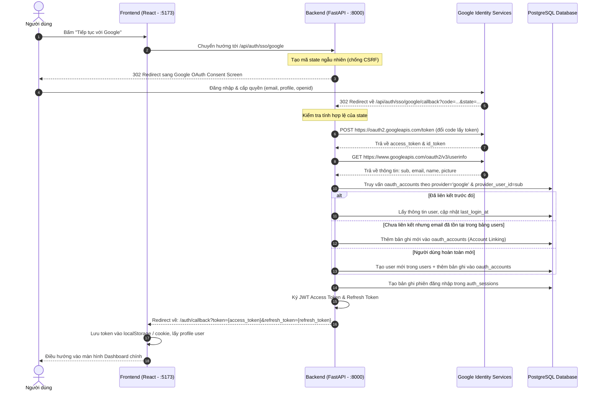

# Kế hoạch triển khai Đăng nhập bằng Google (Google SSO / OAuth 2.0)

> Tài liệu mô tả kiến trúc, luồng xác thực và kế hoạch triển khai chi tiết tính năng đăng nhập bằng tài khoản Google cho hệ thống TaskFlow (IT4409).

---

## 1. Mục tiêu & Hiện trạng

### 1.1 Mục tiêu
- Cho phép người dùng đăng nhập hoặc đăng ký tài khoản nhanh chóng chỉ bằng một lần nhấp chuột qua tài khoản Google.
- Tự động liên kết tài khoản Google với tài khoản sẵn có nếu cùng địa chỉ email.
- Sinh JWT Access Token và Refresh Token, lưu vết phiên đăng nhập vào bảng `auth_sessions` theo đúng thiết kế tại [`docs/database-design.md`](database-design.md).

### 1.2 Hiện trạng dự án
- **Cơ sở dữ liệu:** Bảng `users`, `oauth_accounts` và `auth_sessions` đã được định nghĩa sẵn trong `database/accounts_and_projects.sql`.
- **Frontend:** Đã có giao diện nút "Google" trên trang đăng nhập (`frontend/src/pages/AuthPage.tsx`) và hàm định tuyến `authApi.getSsoUrl('google')`.
- **Backend:** Cần bổ sung thư viện gọi HTTP client (`httpx`), module bảo mật JWT, router xử lý OAuth callback và liên kết tài khoản người dùng trong cơ sở dữ liệu.

---

## 2. Kiến trúc luồng xác thực (OAuth 2.0 Authorization Code Flow)



---

## 3. Các giai đoạn triển khai chi tiết

### Giai đoạn 1: Chuẩn bị Credentials trên Google Cloud Console

1. **Tạo Project:**
   - Đăng nhập vào [Google Cloud Console](https://console.cloud.google.com/).
   - Tạo mới một project: `TaskFlow-IT4409`.
2. **Cấu hình OAuth consent screen (Màn hình đồng thuận):**
   - Loại người dùng: **External**.
   - Nhập tên ứng dụng: `TaskFlow`, email liên hệ quản trị.
   - Thêm các phạm vi truy cập (Scopes):
     - `.../auth/userinfo.email`
     - `.../auth/userinfo.profile`
     - `openid`
   - Trong giai đoạn kiểm thử, thêm email của các thành viên trong nhóm vào danh sách **Test users**.
3. **Tạo OAuth 2.0 Client ID (Web Application):**
   - Application type: **Web application**.
   - Name: `TaskFlow Web Client`.
   - **Authorized JavaScript origins:**
     - `http://localhost:5173`
     - `http://localhost:8000`
   - **Authorized redirect URIs:**
     - `http://localhost:8000/api/auth/sso/google/callback`
4. **Cập nhật file `.env`:**
   ```env
   # Google OAuth Credentials
   GOOGLE_CLIENT_ID=your-google-client-id.apps.googleusercontent.com
   GOOGLE_CLIENT_SECRET=your-google-client-secret
   GOOGLE_REDIRECT_URI=http://localhost:8000/api/auth/sso/google/callback
   FRONTEND_URL=http://localhost:5173
   
   # JWT Configuration
   JWT_SECRET_KEY=generate-a-strong-random-secret-key
   JWT_ALGORITHM=HS256
   ACCESS_TOKEN_EXPIRE_MINUTES=60
   REFRESH_TOKEN_EXPIRE_DAYS=7
   ```

---

### Giai đoạn 2: Cấu hình Backend & Cơ sở dữ liệu

1. **Bổ sung thư viện vào `backend/requirements.txt`:**
   - `httpx>=0.27.0` (Client gọi HTTP bất đồng bộ để giao tiếp với Google API)
   - Lưu ý kiểm tra file `requirements.txt` ở bảng mã UTF-8.
2. **Định nghĩa cấu hình trong Backend (`app/core/config.py`):**
   - Đọc các biến `GOOGLE_CLIENT_ID`, `GOOGLE_CLIENT_SECRET`, `GOOGLE_REDIRECT_URI`, `FRONTEND_URL`, `JWT_SECRET_KEY` bằng `pydantic-settings`.
3. **Xây dựng SQLAlchemy Models (`app/models/`):**
   - `User` (`app/models/user.py`): Ánh xạ bảng `users`.
   - `OAuthAccount` (`app/models/oauth_account.py`): Ánh xạ bảng `oauth_accounts`.
   - `AuthSession` (`app/models/auth_session.py`): Ánh xạ bảng `auth_sessions`.

---

### Giai đoạn 3: Xây dựng Logic xác thực Backend

1. **Security & JWT Utility (`app/core/security.py`):**
   - Tạo Access Token (JWT chứa `sub`: `user_id`, thời hạn ngắn: 60 phút).
   - Tạo Refresh Token (Chuỗi ngẫu nhiên được băm SHA-256 để lưu vào `auth_sessions.refresh_token_hash`).
2. **Google OAuth Service (`app/services/google_oauth.py`):**
   - `get_authorization_url(state: str) -> str`: Tạo URL chuyển hướng người dùng tới Google.
   - `exchange_code_for_token(code: str) -> dict`: Gửi mã authorization code lên `https://oauth2.googleapis.com/token`.
   - `get_user_info(access_token: str) -> dict`: Lấy thông tin tài khoản từ `https://www.googleapis.com/oauth2/v3/userinfo`.
3. **User & Auth Service (`app/services/auth_service.py`):**
   - `handle_google_login(db, user_info, request_info) -> tuple[str, str]`:
     - Kiểm tra `oauth_accounts` theo `provider='google'` và `provider_user_id=user_info['sub']`.
     - Nếu chưa tồn tại:
       - Tìm trong `users` theo `email = user_info['email']`.
       - Nếu có: liên kết thêm vào `oauth_accounts`.
       - Nếu chưa có: tạo `User` mới với `email`, `full_name`, `avatar_url`, `email_verified_at=now()`.
     - Tạo bản ghi mới trong `auth_sessions` (lưu IP, user-agent, hạn dùng refresh token).
     - Ký và trả về `(access_token, refresh_token)`.
4. **Auth Router (`app/api/auth.py`):**
   - `GET /api/auth/sso/google`: Tạo mã `state`, lưu vào cookie/session ngắn hạn, redirect sang Google.
   - `GET /api/auth/sso/google/callback`:
     - Nhận `code` và `state`.
     - Xác thực `state`.
     - Gọi `handle_google_login`.
     - Redirect về Frontend kèm tokens:
       `${FRONTEND_URL}/auth/callback?token=${access_token}&refresh_token=${refresh_token}`.
   - `GET /api/auth/me`: Endpoint xác thực token và trả về thông tin người dùng hiện tại (`UserSummary`).

---

### Giai đoạn 4: Tích hợp và hoàn thiện Frontend

1. **Nút đăng nhập Google trên `AuthPage.tsx`:**
   - Sự kiện bấm nút gọi:
     ```ts
     window.location.assign(authApi.getSsoUrl('google'))
     ```
2. **Trang đón Callback (`frontend/src/pages/AuthCallback.tsx`):**
   - Đọc tham số `token` và `refresh_token` từ URL query parameters.
   - Nếu có lỗi (`error` param): Hiển thị thông báo và chuyển về trang đăng nhập.
   - Nếu thành công:
     - Lưu token vào `localStorage.setItem('taskflow-token', token)`.
     - Lưu `refresh_token` vào `localStorage` hoặc cookie.
     - Gọi API `/api/auth/me` để lấy thông tin người dùng hiện tại và lưu vào `taskflow-current-user`.
     - Chuyển hướng người dùng vào trang làm việc chính (`/` hoặc trang Dashboard).

---

### Giai đoạn 5: Xử lý các trường hợp biên & Bảo mật (Security & Edge Cases)

1. **Chống tấn công CSRF bằng State Token:**
   - Mỗi lần khởi tạo đăng nhập SSO, sinh một chuỗi ngẫu nhiên `state` được mã hóa hoặc lưu trong cookie an toàn (SameSite=Lax, HttpOnly). Khi Google callback về, so sánh state để đảm bảo tính hợp lệ của phiên.
2. **Tài khoản đã tồn tại (Account Linking):**
   - Người dùng từng đăng ký bằng email và mật khẩu thường, sau đó đăng nhập bằng Google với cùng email đó: Hệ thống tự động liên kết tài khoản Google mà không tạo user trùng lặp.
3. **Người dùng từ chối / Hủy cấp quyền:**
   - Khi người dùng bấm "Cancel" trên màn hình Google, Google redirect về callback kèm `error=access_denied`. Backend phát hiện và redirect về Frontend kèm thông báo lỗi thân thiện thay vì hiển thị lỗi hệ thống 500.
4. **Thu hồi phiên đăng nhập (Revocation):**
   - Khi người dùng đăng xuất, cập nhật trường `revoked_at` trong bảng `auth_sessions` để vô hiệu hóa refresh token.

---

## 4. Bảng kiểm tra nghiệm thu (Checklist)

- [ ] Cấu hình thành công OAuth Consent Screen và Client ID trên Google Cloud Console.
- [ ] Thêm biến môi trường Google OAuth vào `.env` và `.env.example`.
- [ ] Cài đặt `httpx` vào backend và cấu hình settings.
- [ ] Xây dựng các router `/api/auth/sso/google` và `/api/auth/sso/google/callback`.
- [ ] Tự động tạo bản ghi mới trong `users` và `oauth_accounts` khi đăng nhập lần đầu.
- [ ] Tự động liên kết tài khoản khi email đã tồn tại sẵn trong hệ thống.
- [ ] Lưu phiên đăng nhập vào `auth_sessions` và trả về JWT hợp lệ.
- [ ] Frontend bắt callback, lưu token và hiển thị đúng tên/avatar của người dùng đăng nhập.
- [ ] Đăng xuất vô hiệu hóa phiên làm việc thành công.

