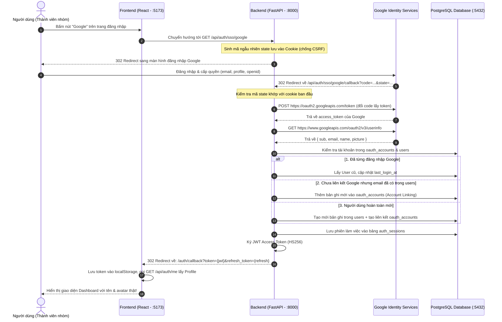

# Tài liệu Kỹ thuật & Hướng dẫn: Đăng nhập Google (Google SSO / OAuth 2.0)

> **Dành cho:** Tất cả thành viên nhóm dự án TaskFlow (IT4409).  
> **Mục đích:** Giải thích kiến trúc luồng dữ liệu, bản đồ mã nguồn và hướng dẫn từng bước để mọi thành viên có thể chạy thử tính năng trên máy cá nhân của mình.

---

## 1. Mục tiêu & Nguyên lý hoạt động

### 1.1 Mục tiêu nghiệp vụ
1. **Đăng nhập nhanh:** Người dùng đăng nhập hoặc tạo tài khoản mới chỉ với 1 cú click qua tài khoản Google cá nhân.
2. **Liên kết tài khoản tự động (Account Linking):** Nếu người dùng đã từng đăng ký bằng email & mật khẩu thường, khi đăng nhập bằng Google với cùng email đó, hệ thống sẽ tự động liên kết tài khoản Google mà không tạo tài khoản trùng lặp.
3. **Quản lý phiên đăng nhập an toàn:** Hệ thống sinh cặp mã **JWT Access Token** (thời hạn 60 phút) và **Refresh Token** (thời hạn 7 ngày, được băm SHA-256 lưu trong bảng `auth_sessions`), cho phép thu hồi phiên đăng nhập khi đăng xuất.

---

## 2. Sơ đồ luồng xác thực (OAuth 2.0 Authorization Code Flow)



---

## 3. Bản đồ mã nguồn (File Mapping)

Để các thành viên dễ dàng đọc hiểu và chỉnh sửa code, tính năng được chia thành các file rõ ràng:

### 3.1 Backend (`backend/app/`)
| File | Vai trò |
|---|---|
| [`core/config.py`](../backend/app/core/config.py) | Đọc cấu hình từ `.env`: `GOOGLE_CLIENT_ID`, `GOOGLE_CLIENT_SECRET`, `JWT_SECRET_KEY`,... |
| [`core/security.py`](../backend/app/core/security.py) | Hàm tạo/giải mã JWT (`create_access_token`, `decode_access_token`) và băm refresh token. |
| [`models/`](../backend/app/models/) | Định nghĩa các thực thể SQLAlchemy: `User` (`users`), `OAuthAccount` (`oauth_accounts`), `AuthSession` (`auth_sessions`). |
| [`schemas/user.py`](../backend/app/schemas/user.py) | Schema Pydantic `UserSummary` tương thích 100% với kiểu dữ liệu của Frontend. |
| [`services/google_oauth.py`](../backend/app/services/google_oauth.py) | Giao tiếp với Google API: tạo URL đăng nhập, đổi code lấy token, lấy userinfo. |
| [`services/auth_service.py`](../backend/app/services/auth_service.py) | Xử lý nghiệp vụ: kiểm tra user, tự động tạo mới/liên kết tài khoản và tạo phiên trong DB. |
| [`api/deps.py`](../backend/app/api/deps.py) | Dependency `get_current_user` trích xuất thông tin người dùng từ Bearer token. |
| [`api/auth.py`](../backend/app/api/auth.py) | Router cung cấp các API: `/sso/google`, `/sso/google/callback`, `/me`, `/logout` (đã có docstring chi tiết Input/Output). |

### 3.2 Frontend (`frontend/src/`)
| File | Vai trò |
|---|---|
| [`pages/AuthPage.tsx`](../frontend/src/pages/AuthPage.tsx) | Màn hình đăng nhập chứa nút bấm Google. |
| [`services/authApi.ts`](../frontend/src/services/authApi.ts) | Chứa `getSsoUrl(provider)` và hàm `getMe(token)` lấy profile người dùng. |
| [`App.tsx`](../frontend/src/App.tsx) | Có `useEffect` tự động đón tham số `?token=...` từ URL callback, lưu vào `localStorage` và chuyển vào trang chính. |

---

## 4. Hướng dẫn chạy trên máy cá nhân

Khi một thành viên trong nhóm kéo code mới về (`git pull origin feature/loginsso`), hãy thực hiện các bước sau để chạy thử:

### Bước 1: Chuẩn bị file `.env`
File `.env` chứa mật khẩu bí mật nên không được đẩy lên GitHub. Hãy copy từ `.env.example`:
```bash
cp .env.example .env
```
Mở file `.env` và điền
```bash
# Google SSO OAuth 2.0
GOOGLE_CLIENT_ID=<dien_client_id_do_trang_gui_tren_zalo>
GOOGLE_CLIENT_SECRET=<dien_client_secret_do_trang_gui_zalo>
GOOGLE_REDIRECT_URI=http://localhost:8000/api/auth/sso/google/callback
FRONTEND_URL=http://localhost:5173

# JWT Security
JWT_SECRET_KEY=<dien_jwt_secret_key_ngau_nhien>
JWT_ALGORITHM=HS256
ACCESS_TOKEN_EXPIRE_MINUTES=60
REFRESH_TOKEN_EXPIRE_DAYS=7
```

### Bước 2: Nạp bảng vào Database (Bắt buộc chạy lần đầu)
Nếu container PostgreSQL trên máy mới tạo hoặc chưa có các bảng `users`, hãy chạy lệnh nạp 31 bảng:
```bash
docker compose cp ./database db:/database && docker compose exec -w /database db psql -U task_user -d task_db -f migrate.sql
```

### Bước 3: Khởi động hệ thống bằng Docker
```bash
docker compose up -d --build
```
Kiểm tra trạng thái các container:
```bash
docker compose ps
```
Cả 4 container (`frontend`, `backend`, `db`, `minio`) phải ở trạng thái `Up`.

### Bước 5: Mở trình duyệt và kiểm tra
1. Truy cập: [**http://localhost:5173**](http://localhost:5173)
2. Bấm vào nút **Google**.
3. Đăng nhập bằng Gmail của bạn $\rightarrow$ Web sẽ tự động chuyển vào Dashboard làm việc với tên và ảnh đại diện Google thật của bạn!

---

## 5. Danh mục API Xác thực (Dành cho thành viên Frontend & Backend tra cứu)

Mọi người có thể mở trực tiếp trang [**http://localhost:8000/docs**](http://localhost:8000/docs) để xem Swagger UI tương tác.

| Phương thức | Đường dẫn API | Mục đích | Input | Output |
|---|---|---|---|---|
| `GET` | `/api/auth/sso/google` | Bắt đầu đăng nhập Google | Không có | 302 Redirect sang Google Login |
| `GET` | `/api/auth/sso/google/callback` | Callback từ Google | `code`, `state` (query params) | 302 Redirect về Frontend kèm JWT token |
| `GET` | `/api/auth/me` | Lấy profile người dùng hiện tại | Header `Authorization: Bearer <token>` | 200 OK: JSON `UserSummary` |
| `POST` | `/api/auth/logout` | Đăng xuất | Header Bearer (tùy chọn) | 200 OK: `{"status": "ok"}` |
| `GET` | `/health` | Kiểm tra trạng thái Backend | Không có | 200 OK: `{"status": "ok"}` |

---

## 6. Xử lý các trường hợp biên & Bảo mật (Security & Edge Cases)

1. **Phòng chống tấn công CSRF (State Token):**
   * Khi gọi `/sso/google`, Backend sinh ra một chuỗi ngẫu nhiên `state` và gán vào Cookie bảo mật (`HttpOnly`, `SameSite=Lax`).
   * Khi Google gửi callback về, Backend so sánh `state` trên URL và trong Cookie. Nếu không khớp sẽ từ chối để tránh người dùng bị đăng nhập mạo danh.
2. **Người dùng bấm Hủy (Cancel):**
   * Nếu người dùng từ chối cấp quyền, Google gửi về tham số `error=access_denied`. Backend bắt lỗi và điều hướng về Frontend hiển thị thông báo thay vì sập hệ thống.
3. **Liên kết tài khoản trùng Email:**
   * Nếu người dùng đăng ký tài khoản thường trước đó (`email = user@gmail.com`), sau đó đăng nhập bằng Google với cùng email: Hệ thống tự động thêm bản ghi vào `oauth_accounts` trỏ đến `user_id` cũ, giúp người dùng không bị mất dữ liệu công việc đã tạo.
