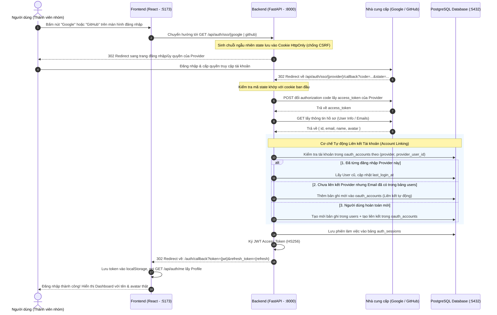
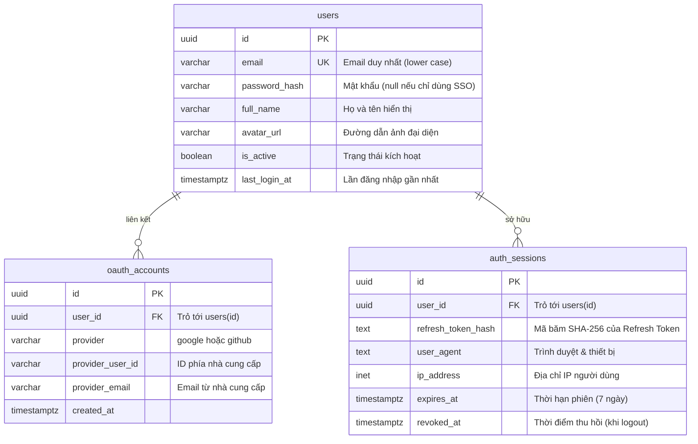

# Tài liệu Kỹ thuật & Hướng dẫn: Đăng nhập SSO (Google & GitHub OAuth 2.0)

> **Dành cho:** Tất cả thành viên nhóm dự án TaskFlow (IT4409).  
> **Mục đích:** Tài liệu tổng hợp duy nhất giải thích toàn bộ kiến trúc xác thực SSO, luồng dữ liệu OAuth 2.0, cơ chế liên kết tài khoản (Account Linking), bản đồ mã nguồn và hướng dẫn chạy thực tế trên máy cá nhân.

---

## 1. Tổng quan & Kiến trúc Xác thực (Authentication Architecture)

### 1.1 Mục tiêu nghiệp vụ
1. **Đăng nhập nhanh (1-Click Login):** Thành viên hoặc người dùng có thể đăng nhập hoặc tạo tài khoản mới tức thì qua Google hoặc GitHub mà không cần nhập mật khẩu thủ công.
2. **Liên kết tài khoản tự động (Account Linking):**
   * Nếu người dùng đã đăng ký bằng email & mật khẩu thường: khi đăng nhập bằng Google hoặc GitHub có **cùng email**, hệ thống sẽ tự động liên kết vào tài khoản cũ.
   * Nếu người dùng đăng nhập bằng Google trước, sau đó đăng nhập bằng GitHub có cùng email: Cả 2 phương thức đều trỏ về **cùng một tài khoản `User` duy nhất**. Toàn bộ công việc, dự án và lịch sử làm việc được bảo toàn nguyên vẹn.
3. **Quản lý phiên đăng nhập an toàn bằng JWT & Session:**
   * **Access Token:** Định dạng JWT (chuẩn HS256, thời hạn 60 phút), chứa `user_id`, được gửi kèm mỗi request qua Header `Authorization: Bearer <token>`.
   * **Refresh Token:** Chuỗi ngẫu nhiên an toàn (thời hạn 7 ngày), được băm SHA-256 và lưu trong bảng `auth_sessions`, cho phép gia hạn phiên và có thể thu hồi khi người dùng đăng xuất.

---

## 2. Sơ đồ luồng hoạt động chuẩn hóa (OAuth 2.0 Authorization Code Flow)



---

## 3. Bảng so sánh kỹ thuật: Google OAuth vs GitHub OAuth

| Tiêu chí | Google OAuth 2.0 | GitHub OAuth 2.0 |
|---|---|---|
| **Auth URL** | `https://accounts.google.com/o/oauth2/v2/auth` | `https://github.com/login/oauth/authorize` |
| **Token URL** | `https://oauth2.googleapis.com/token` | `https://github.com/login/oauth/access_token` |
| **User Info URL** | `https://www.googleapis.com/oauth2/v3/userinfo` | `https://api.github.com/user` |
| **Định dạng Token trả về** | Chuẩn JSON | Mặc định URL-encoded $\rightarrow$ **Bắt buộc gửi Header:** `Accept: application/json` |
| **Yêu cầu Header bắt buộc** | Không | Bắt buộc phải có `User-Agent: TaskFlow-App` (thiếu sẽ bị lỗi 403) |
| **Quyền yêu cầu (Scopes)** | `openid email profile` | `read:user user:email` |
| **Trường ID định danh** | `sub` (chuỗi số/ký tự) | `id` (số nguyên $\rightarrow$ ép kiểu `str`) |
| **Xử lý Email ẩn (Private)** | Google luôn trả về email chính xác | GitHub có thể trả về `email: null` $\rightarrow$ **Cần gọi thêm endpoint:** `GET https://api.github.com/user/emails` để bóc tách email chính |

---

## 4. Thiết kế Cơ sở dữ liệu (Database Schema)

Cấu trúc lưu trữ xác thực gồm 3 bảng trong PostgreSQL:



* Ràng buộc bảng [`oauth_accounts`]:
  * `CHECK (provider IN ('google', 'github'))`
  * `UNIQUE (provider, provider_user_id)`: Một tài khoản mạng xã hội không thể gán cho 2 user khác nhau.
  * `UNIQUE (user_id, provider)`: Mỗi user chỉ liên kết tối đa 1 tài khoản Google và 1 tài khoản GitHub.

---

## 5. Bản đồ mã nguồn (Source Code Map)

### 5.1 Backend (`backend/app/`)
| File | Chức năng cụ thể |
|---|---|
| [`core/config.py`] | Đọc cấu hình từ `.env`: Client ID, Secret, Redirect URI cho cả Google và GitHub, thiết lập thời hạn JWT. |
| [`core/security.py`] | Hàm tạo/giải mã Access Token (`create_access_token`) và băm Refresh Token (`generate_refresh_token`). |
| [`models/`] | Định nghĩa SQLAlchemy: `User`, `OAuthAccount`, `AuthSession`. |
| [`services/google_oauth.py`] | Giao tiếp Google API: tạo auth URL, đổi code lấy token, lấy userinfo Google. |
| [`services/github_oauth.py`] | Giao tiếp GitHub API: tạo auth URL, đổi code lấy token (header JSON + User-Agent), bóc tách email từ `/user/emails`. |
| [`services/auth_service.py`] | **Hạt nhân nghiệp vụ:** Hàm `handle_oauth_login` xử lý tra cứu/tạo mới tài khoản, tự động **Account Linking**, ghi nhận phiên trong `auth_sessions`. |
| [`api/deps.py`] | Dependency `get_current_user` trích xuất và xác thực Bearer Token từ Request Header. |
| [`api/auth.py`] | Router cung cấp các API: `/sso/google`, `/sso/google/callback`, `/sso/github`, `/sso/github/callback`, `/me`, `/logout`. |

### 5.2 Frontend (`frontend/src/`)
| File | Chức năng cụ thể |
|---|---|
| [`pages/AuthPage.tsx`] | Màn hình đăng nhập/đăng ký chứa nút bấm Google và GitHub. |
| [`services/authApi.ts`] | Định nghĩa `getSsoUrl(provider)`, `getMe(token)`, `logout()`. |
| [`App.tsx`] | `useEffect` lắng nghe tham số `?token=...&refresh_token=...` từ URL callback, lưu vào `localStorage`, gọi `/api/auth/me` để lấy thông tin người dùng và chuyển vào Dashboard. |

---

## 6. Hướng dẫn chạy thử trên máy cá nhân (Local Setup)

Mọi thành viên sau khi kéo code từ git (`git pull`) chỉ cần thực hiện 4 bước sau:

### Bước 1: Chuẩn bị file `.env`
Sao chép từ `.env.example` (nếu chưa có file `.env`):
```bash
cp .env.example .env
```
Mở file `.env` và điền/kiểm tra các cấu hình sau (thông tin ID/Secret của nhóm đã được cấu hình sẵn trong kho dự án):
```bash
https://project.aiservice.vn/projects/e82b8c53-46ba-4933-bc09-4aeed9bff681/tasks?task=WQLC-2
```

### Bước 2: Nạp cấu trúc Database (Chỉ cần chạy 1 lần đầu tiên)
Nếu PostgreSQL của bạn vừa tạo mới hoặc chưa nạp bảng:
```bash
docker compose cp ./database db:/database && docker compose exec -w /database db psql -U task_user -d task_db -f migrate.sql
```

### Bước 3: Khởi động hệ thống với Docker
```bash
docker compose up -d --build
```
Kiểm tra trạng thái container bằng `docker compose ps`. Cả 4 container (`frontend`, `backend`, `db`, `minio`) phải ở trạng thái `Up`.

### Bước 4: Kiểm thử trên trình duyệt
1. Mở trình duyệt tại: [**http://localhost:5173**](http://localhost:5173)
2. **Kiểm tra đăng nhập Google:** Bấm nút **Google** $\rightarrow$ Đăng nhập tài khoản Gmail $\rightarrow$ Web tự chuyển vào Dashboard.
3. **Kiểm tra đăng nhập GitHub:** Đăng xuất, sau đó bấm nút **GitHub** $\rightarrow$ Bấm Authorize trên GitHub $\rightarrow$ Web tự chuyển vào Dashboard.
4. **Kiểm tra Account Linking:** Nếu tài khoản Google và GitHub của bạn có cùng địa chỉ email, hệ thống sẽ tự động gộp vào cùng một người dùng (kiểm tra thấy toàn bộ dự án và task không bị tách biệt).

---

## 7. Danh mục API Xác thực (Swagger UI: `http://localhost:8000/docs`)

| Phương thức | Đường dẫn API | Mục đích | Input | Output |
|---|---|---|---|---|
| `GET` | `/api/auth/sso/google` | Khởi tạo đăng nhập Google | Không có | 302 Redirect sang Google Login |
| `GET` | `/api/auth/sso/google/callback` | Callback từ Google | `code`, `state` (query params) | 302 Redirect về Frontend kèm JWT token |
| `GET` | `/api/auth/sso/github` | Khởi tạo đăng nhập GitHub | Không có | 302 Redirect sang GitHub Authorize |
| `GET` | `/api/auth/sso/github/callback` | Callback từ GitHub | `code`, `state` (query params) | 302 Redirect về Frontend kèm JWT token |
| `GET` | `/api/auth/me` | Lấy profile người dùng hiện tại | Header `Authorization: Bearer <token>` | 200 OK: JSON `UserSummary` |
| `POST` | `/api/auth/logout` | Đăng xuất người dùng | Header Bearer (tùy chọn) | 200 OK: `{"status": "ok"}` |
| `GET` | `/health` | Kiểm tra trạng thái Backend | Không có | 200 OK: `{"status": "ok"}` |

---

## 8. Bảo mật & Xử lý các trường hợp biên (Security & Edge Cases)

1. **Phòng chống tấn công CSRF (State Token):**
   * Backend tạo chuỗi ngẫu nhiên `state` an toàn mật mã học (`secrets.token_urlsafe(32)`) và gán vào Cookie `oauth_state` (`HttpOnly`, `SameSite=Lax`, sống 10 phút).
   * Khi nhà cung cấp gọi callback về, Backend so sánh `state` trên URL và `state` trong Cookie. Nếu không khớp sẽ hủy luồng ngay lập tức.
2. **Người dùng bấm Hủy (Cancel/Denied):**
   * Nếu người dùng từ chối ủy quyền, Google gửi về `error=access_denied`, GitHub gửi về `error=access_denied`. Backend bắt lỗi và điều hướng an toàn về `${FRONTEND_URL}?error=access_denied` thay vì sập 500.
3. **Bóc tách Email ẩn trên GitHub (Private Email):**
   * Nếu người dùng cài đặt ẩn email trên GitHub, trường `email` ở API `/user` sẽ là `null`. Backend tự động gọi thêm API `https://api.github.com/user/emails` để trích xuất email đã được xác minh (`verified: true, primary: true`).
4. **Fallback Tên người dùng:**
   * GitHub không bắt buộc người dùng đặt tên thật (`name`), nhiều tài khoản chỉ có username (`login`). Backend tự động fallback: `name = user.get("name") or user.get("login")` để giao diện luôn hiển thị đẹp mắt.
5. **Thu hồi phiên đăng nhập (Revocation):**
   * Khi gọi `/api/auth/logout`, hệ thống xóa sạch token ở Frontend `localStorage` và ghi nhận trạng thái thu hồi trong cơ sở dữ liệu.

